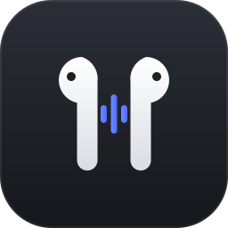
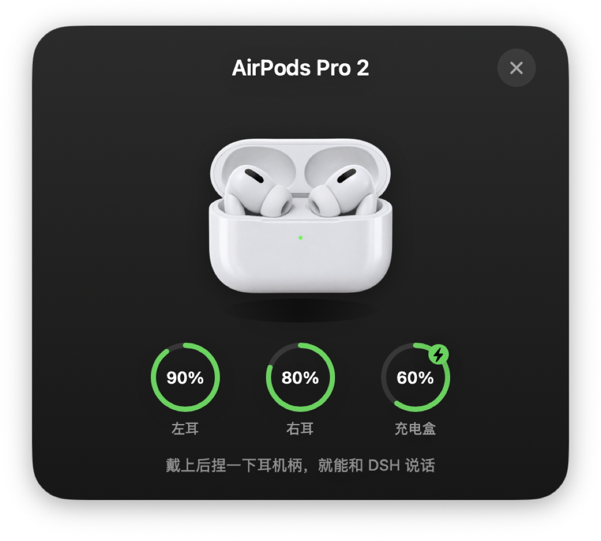
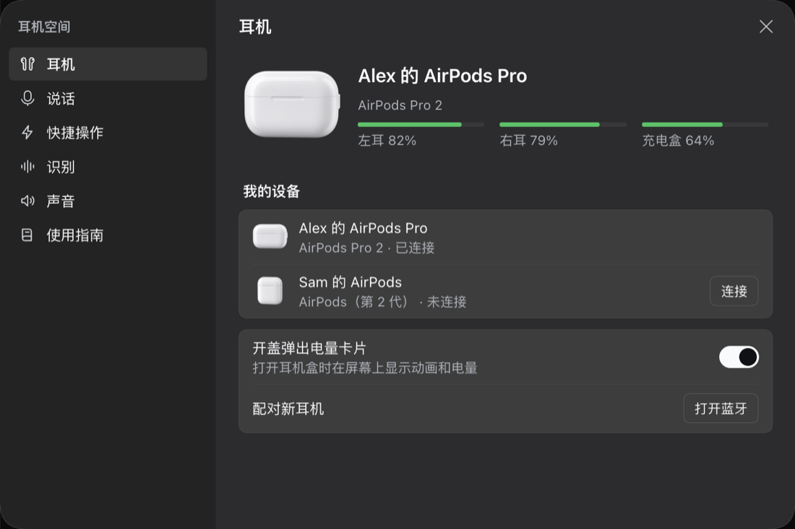
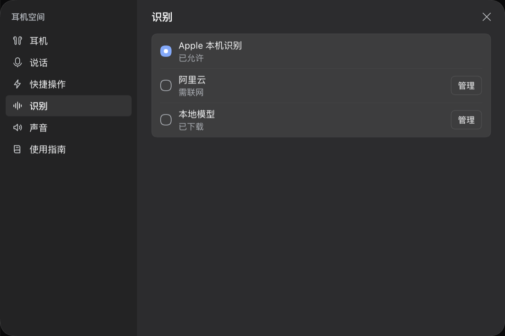
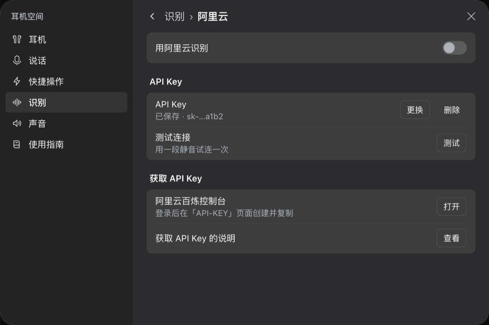
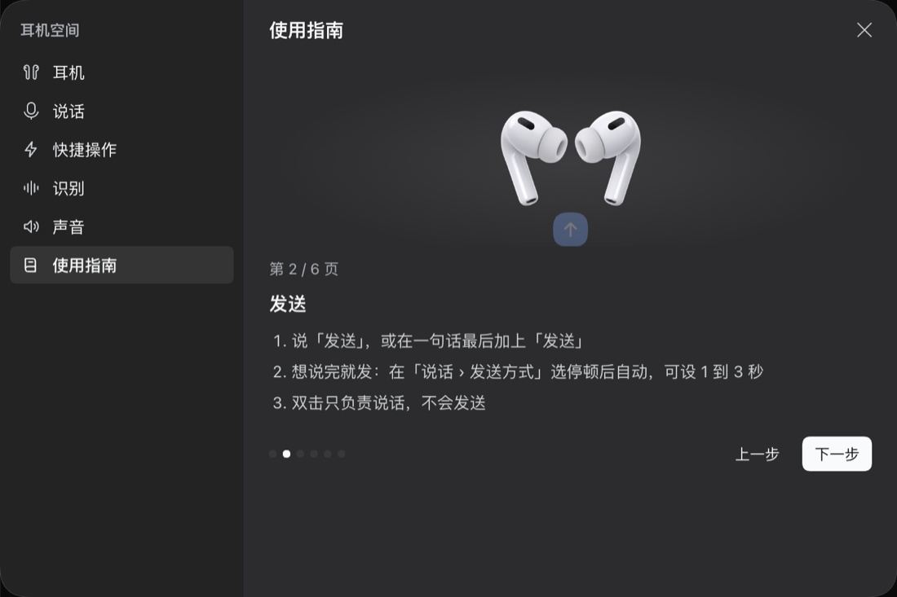
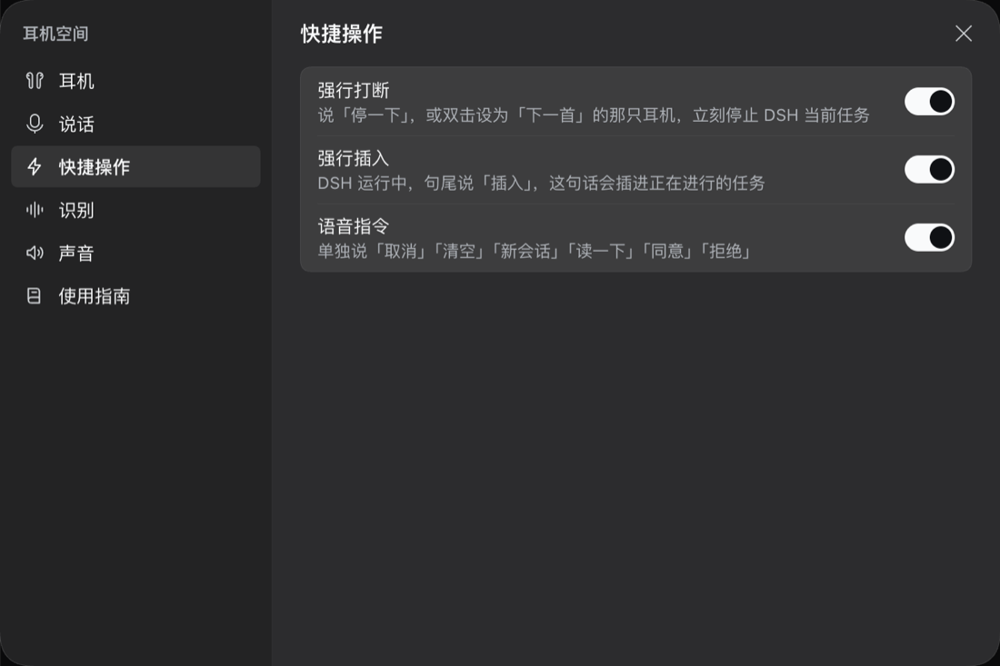
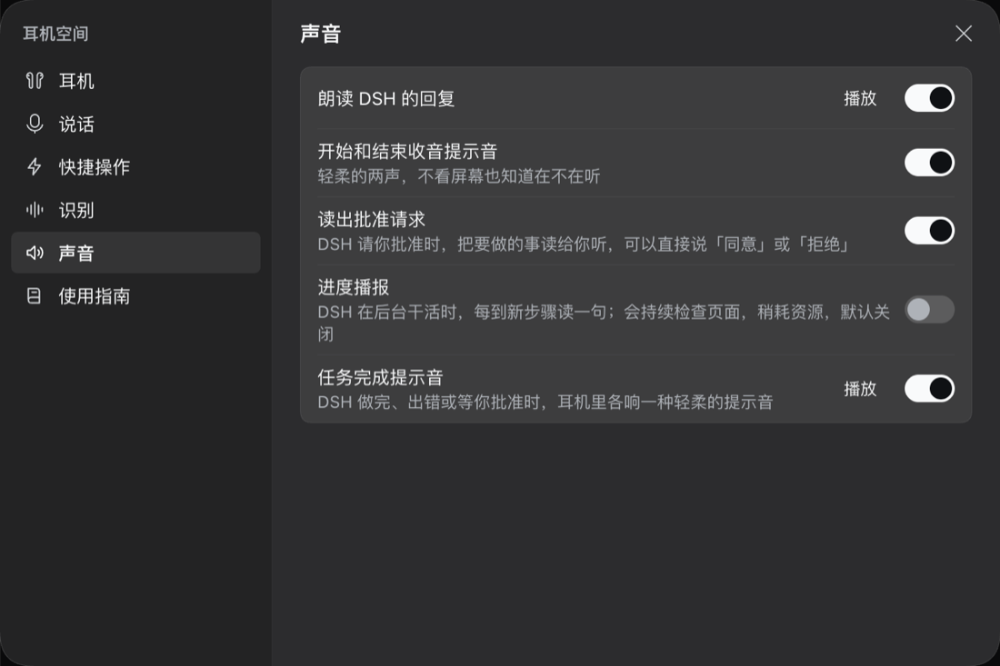

<div align="center">



# 耳机空间 · AirPods Space

**戴上 AirPods，轻点一下就能和 DeepSeek Harness 说话**

[](#开发)
[](https://github.com/deepseek-ai/deepseek-harness)
[](LICENSE)




</div>

戴上 AirPods，轻点一下就能和 [DeepSeek Harness](https://github.com/deepseek-ai/deepseek-harness)（DSH）说话：说的话实时出现在输入框，说「发送」或停顿后自动发出；DSH 的回复可以读到耳机里，任务完成有提示音，离开屏幕也能继续指挥它干活。

> 本仓库基于 DeepSeek Harness（MIT）。插件代码全部在 [`packages/airpods/`](packages/airpods)，对 DSH 本体只做了接入所需的少量改动。上游原始说明见 [README.upstream.md](README.upstream.md)。

## 功能

- **按耳机说话**：AirPods 1/2 轻点两下，AirPods 3/4/Pro 捏耳机柄，AirPods Max 按数码表冠
- **流式识别**：Apple 本机识别（默认，免下载）、阿里云实时识别、本地 Paraformer 模型；不可用时自动回退
- **发送方式**：说「发送」（单独说或句尾带），或停顿 1–3 秒自动发送；句尾说「插入」把话插进正在运行的任务
- **快捷操作**：「停一下」强行打断、语音指令（取消、清空、新会话、读一下、同意、拒绝），每项可单独开关
- **声音**：朗读 DSH 的回复，任务完成提示音
- **开盖卡片**：打开耳机盒时弹出 iOS 风格的电量动画（可关闭），支持全部 AirPods 型号
- **精确识别型号**：按产品 ID 识别型号，自动适配手势和使用指南
- **设置窗口**：系统设置式布局，耳机 / 说话 / 快捷操作 / 识别（阿里云、本地模型子页）/ 声音 / 使用指南（带动画）
- **冲突检测**：别的应用抢走耳机按键时提示，切回 DSH 自动拿回
- **8 种语言**：中、英、日、西、法、德、俄、葡

## 截图

| 说话时，字实时进输入框 | 说完等你说「发送」 |
|---|---|
|  |  |

| 耳机：型号、电量、设备切换 | 识别：Apple / 阿里云 / 本地模型 |
|---|---|
|  |  |
| **阿里云：Key、测试连接、百炼控制台** | **使用指南：按型号分页，带动画** |
|  |  |
| **快捷操作：打断、插入、语音指令** | **声音：朗读、提示音、进度播报** |
|  |  |

> 截图中的耳机名称为演示用的占位名。

## 目录

| 路径 | 内容 |
|---|---|
| `packages/airpods/airpods-helper` | Swift 原生助手：蓝牙、开盖卡片、录音、手势、朗读、Apple 识别 |
| `packages/airpods/airpods-space` | Host 插件：助手进程生命周期、识别轮次、语音指令、`airpods` Remote |
| `packages/airpods/client-ui-airpods-space` | 输入框耳机按钮、菜单、设置窗口、设置向导 |
| `packages/airpods/speech-streaming*` | 流式识别注册表，以及本地模型、阿里云两种实现 |
| `packages/airpods/airpods-space-bundle` | 插件包：配置、图标、宣传图、插件说明 |
| `packages/airpods/docs` | 需求拆分、耳机按压方案研究、开发与分发 |

## 开发

需要 macOS 14+、Node 24、pnpm、Xcode 命令行工具。

```sh
pnpm install
packages/airpods/airpods-helper/scripts/build.sh   # 编译 Swift 助手（改了 Swift 才需要）
pnpm run build:artifacts
pnpm run start:desktop                              # 开发版 Harness Dev
npx vitest run packages/airpods                     # 单元测试
pnpm run build:check                                # 全量类型检查
```

打包正式版：`NODE_USE_ENV_PROXY=1 pnpm run package:desktop:mac:arm64:unsigned`，产物在 `apps/desktop/.desktop-build/targets/mac-arm64/unsigned-artifacts/`。详见 [开发与分发](packages/airpods/docs/开发与分发.md)。

## 隐私

- 只在你按下耳机后才录音，说完立即关麦
- Apple 识别和本地模型都在本机处理；阿里云识别需要联网
- 阿里云 API Key 只保存在本机钥匙串（`dshub.aliyun.dashscope`），不写进任何文件

## 许可

MIT，与上游 DeepSeek Harness 相同。
