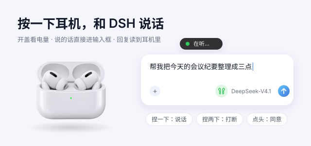

## 开启

1. 打开 DSH，进入「插件」，在「实验性插件」里找到「耳机空间」，打开开关。不用重启。
2. 第一次启用会弹出设置向导：选择语音识别方式、允许麦克风、看一眼手势说明。
3. 连接 AirPods。第一次连接某个型号时，桌面中央会出现手势指南。完整的使用指南在输入框耳机菜单 ›「设置…」›「使用指南」。

## 怎么用

| 想做的事 | AirPods 3 代 / 4 代 / Pro | AirPods 1 代 / 2 代 | AirPods Max |
|---|---|---|---|
| 开始说话 | 捏一下 | 轻点两下（设为「播放/暂停」的那只） | 按一下数码表冠 |
| 发送 | 单独说「发送」或句尾带「发送」；也可在「设置 › 说话」改成停顿 1–3 秒后自动发送 | 同左 | 同左 |
| 打断 DSH、停止朗读 | 捏两下 | 轻点两下另一只（设为「下一首」） | 按两下数码表冠 |
| 撤销刚说的 | 捏三下 | 说「取消」 | 说「取消」 |
| 同意 / 拒绝操作 | 点头 / 摇头 | 说「同意」/「拒绝」 | 点头 / 摇头 |

AirPods 1 代和 2 代需要设置一次：系统设置 › 蓝牙 › 你的 AirPods ⓘ，把一只耳机的「轻点两下」设为「播放/暂停」（只戴一只也够用）；另一只可以设为「下一首」，用来打断 DSH。

**语音指令**：一整句话只说下面这些词时才会执行，其他句子都当作正常内容发给 DSH。

「停一下」打断 ·「发送」立即发送 ·「取消」/「算了」丢掉这句 ·「新会话」·「清空」·「读一下」朗读上一条回复 ·「同意」/「拒绝」

## 输入框上的耳机图标

| 颜色 | 含义 |
|---|---|
| 白色 | 可以说话 |
| 黄色 | 耳机没连接，或者没戴上 |
| 红色 | 需要处理：没有权限、出错、按键被别的 App 占用（悬停看原因，点开菜单可以修复） |
| 绿色呼吸 | 正在听 |
| 细圆环 | 本地模型下载中 |
| 右上角红点 | 耳机电量低于 10% |

点图标打开菜单，可以：看每副耳机的电量；把耳机连接到这台 Mac；切换发送方式和识别方式；开关朗读；重新打开设置向导。

## 语音识别方式

| 方式 | 特点 |
|---|---|
| Apple 本机识别（默认） | 在这台 Mac 上处理，免下载、不联网；第一次使用要允许「语音识别」 |
| 阿里云 | 识别最准（中英混说也很好），需要联网和阿里云 API Key |
| 本地模型 | 完全离线，需要下载约 240 MB；只有选它时才会下载，可以随时取消 |

阿里云 Key 的读取顺序：插件配置 `apiKey` › 环境变量 `DASHSCOPE_API_KEY` › macOS 钥匙串（账户 `dshub`，服务 `dshub.aliyun.dashscope`）。云端连不上时，这一句会自动改用本地模型。

## 隐私

- 只有在你按下耳机（或点「开始说话」）后才录音，说完就停。开麦期间 macOS 右上角会显示橙色麦克风点。
- 录音只从 AirPods 的麦克风采集。没连 AirPods 时不会录音，也不会改用 Mac 自带的麦克风。
- 选 Apple 或本地模型时，声音不会离开这台 Mac。选阿里云时，录音会发给阿里云做识别。

## 常见问题

| 现象 | 处理 |
|---|---|
| 按耳机没反应，图标是红色并提示被某个 App 占用 | 点菜单里的「把耳机按键交给 DSH」，或者退出那个 App |
| 系统没弹出权限请求 | 系统设置 › 隐私与安全性 › 麦克风 / 语音识别 / 蓝牙，打开「DSH AirPods」 |
| 开盖后耳机连到了 iPhone | 在弹出的卡片上点「连接到这台 Mac」，或者在菜单里点那副耳机 |
| 说慢了被提前发出 | 设置 › 说话 › 发送方式选「说『发送』」，或把停顿调到 3 秒 |
| 不想听朗读 | 菜单里取消「朗读 DSH 的回复」，或者朗读时按一下耳机 |
